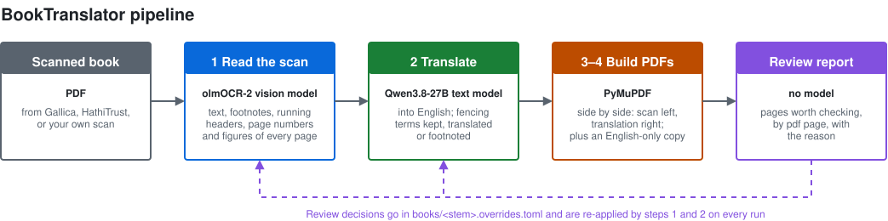

# FencingManualTranslator

Turns a scanned historical fencing manual into an English study edition:
the original page on the left, the translation on the right, page
for page. Everything runs on local hardware, and no text is sent to a
cloud service.

This project is built for reading and research. It grew out of finding
public-domain fencing manuals with no English translation available. Every
translation is machine-made, but the prompting has been tailored to fencing
terminology through many rounds of human review, and the layout engine
handles the quirks of historical printing, from old-style page numbers to
margin notes and engraved plates.

The output is not intended to replace translations by professional
scholars. It fills gaps in the study of historical fencing manuals that
have not yet received a translator's attention.

## What it produces

- **Side by Side (Landscape) PDF**: scan on the left, translation on the
  right. Running heads, chapter titles, page numbers, the author's
  footnotes and margin notes, and plate captions are carried over.
- **English Only (Portrait) PDF**: a flowing reading copy with figures
  inline.
- **A cover page** naming the models used and the pipeline revision and
  date behind the translation.
- **A review report** listing the pages worth checking, and why.

Pages the model struggled with are marked in the output
(`[low-confidence translation — review]`), and `†` footnotes give the
original wording of terms whose English is only an approximation.

## How it works

The models read the page and draft the translation; the pipeline around
them does most of the work.

- **Layout first.** A layout detector locates text, figures, tables and
  margin notes before the vision model reads each page.
- **Book structure rebuilt.** Page numbers are reconciled across the book,
  running heads cross-checked, hyphenation across page breaks rejoined,
  scan-library stamps removed, footnotes and margin notes kept in place.
- **A term glossary per language.** Each source language has its own
  glossary, since each fencing tradition has its own vocabulary; a new
  language starts by building one. Every term is translated, translated
  with the original in a footnote, or kept in italics as English fencing
  literature keeps it. The lists come from surveying every term in the
  corpus, with per-book entries where an author defines a word his own
  way.
- **Checks after the model.** Code enforces the term policy, repairs known
  model errors, and retries or flags any page left partly untranslated.
- **Measured.** Output is scored against published sample human
  translations; the translation model was chosen by a comparative test;
  every fixed bug is a regression test, so a fix for one book cannot
  silently break another.
- **Review loop.** Reviewer decisions go in a per-book overrides file that
  every later run re-applies, and only pages whose source text changed are
  retranslated.



Four steps, each a script in `pipeline/`:

| Step | Does |
|---|---|
| 1 | Page layout, OCR and structure: scan → text with page numbers, heads, figures |
| 2 | Translation, term policy and checks → English |
| 3 | English Only PDF |
| 4 | Side by Side PDF |

Every intermediate file is kept, so any step can be rerun without
redoing the earlier ones. Step by step, with the files each step reads
and writes: [detailed pipeline diagram](docs/img/pipeline-detail.drawio.svg).

## Architecture: local models on a consumer GPU

- **Models.** Two open-weight models, both run through
  [llama.cpp](https://github.com/ggml-org/llama.cpp): olmOCR-2-7B (a
  vision model trained for document OCR) reads the pages, and
  Qwen3.8-27B translates. They take turns on the GPU; the pipeline starts
  and stops each server as it needs it. The layout detector (Docling's
  RT-DETR) runs on the CPU.
- **Hardware.** Developed on a 16 GB AMD RX 9070 XT (RDNA4). The 27B
  translation model does not fit in 16 GB, so it is split between GPU
  and CPU. A 350-page book takes about an hour to read and four to five
  hours to translate.
- **Self-contained container.** The Docker image carries the whole GPU
  stack: ROCm 7.2 and Vulkan builds of llama.cpp, switchable without a
  rebuild. The host needs only a recent kernel and Docker, with no
  ROCm or driver install.
- **Remote GPU option.** Inference can instead run on another system on
  your network (a `llama-server` or llama-swap, e.g. a Windows gaming PC).
  The pipeline host then needs no GPU at all.
- **NVIDIA.** Untested. A CUDA `llama-server` works through remote mode
  as it stands, even on the same system; a CUDA backend inside the
  container is outlined but not built
  ([`docs/remote-gpu.md`](docs/remote-gpu.md) §5).

Hardware, software stack and backends in detail:
[`setup/MANUAL_SECTION_I_OVERVIEW.md`](setup/MANUAL_SECTION_I_OVERVIEW.md);
remote mode: [`docs/remote-gpu.md`](docs/remote-gpu.md).

## Quick start

```bash
bash scripts/setup.sh          # checks the host, builds the image (~20-30 min)
                               # (--remote for a host without a GPU)
                               # local mode: the first start downloads ~13 GB of models

# put scans in ./books/ as <author>_<year>_<short-title>.pdf, then:
scripts/run_full_pipeline.sh
```

Running steps individually, reviewing a book, and troubleshooting:
[`setup/MANUAL_SECTION_III_USAGE.md`](setup/MANUAL_SECTION_III_USAGE.md).

## Status

- **French:** nine manuals (1818–1912) translated and under review.
- **Italian:** ten manuals (1844–1905) in progress.
- **English Only PDF:** has known layout issues; the side-by-side edition
  is the primary output.

## Source scans

No books are included. Put your own scans in `books/`; public-domain
sources such as Gallica, Google Books and archive.org work well. The
`books/` and `processed/` folders are excluded from git, so your scans
and their translations are never committed.

## License

Copyright (C) 2026 Nicholas A. Caccamo.

The code is licensed under the [GNU Affero General Public License v3.0 or
later](LICENSE). You may use, modify and share it; modified versions,
including ones offered as an online service, must be released under the
same license with their source.

- **Models** are downloaded at setup, not included here, and each keeps
  its own license (see the model pages).
- **Translations** the pipeline produces are machine output; the cover
  page of each PDF dedicates it to the public domain (CC0 1.0). The
  source books are your own scans of public-domain works.

## Documentation

- **User manual:**
  [overview](setup/MANUAL_SECTION_I_OVERVIEW.md) ·
  [host setup](setup/MANUAL_SECTION_II_HOST_PREREQUISITES.md) ·
  [usage](setup/MANUAL_SECTION_III_USAGE.md)
- **How it works:** [model failure modes and fixes](docs/model-quirks.md) ·
  [PDF layout](docs/pdf-layout.md) · [remote GPU](docs/remote-gpu.md)
- **For contributors:** [current status](docs/STATUS.md) ·
  [evaluation and tuning](docs/evaluation-and-tuning.md)
