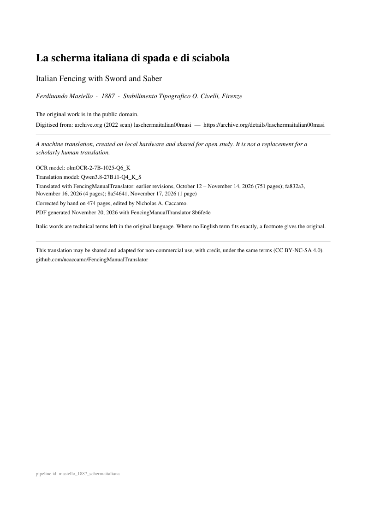
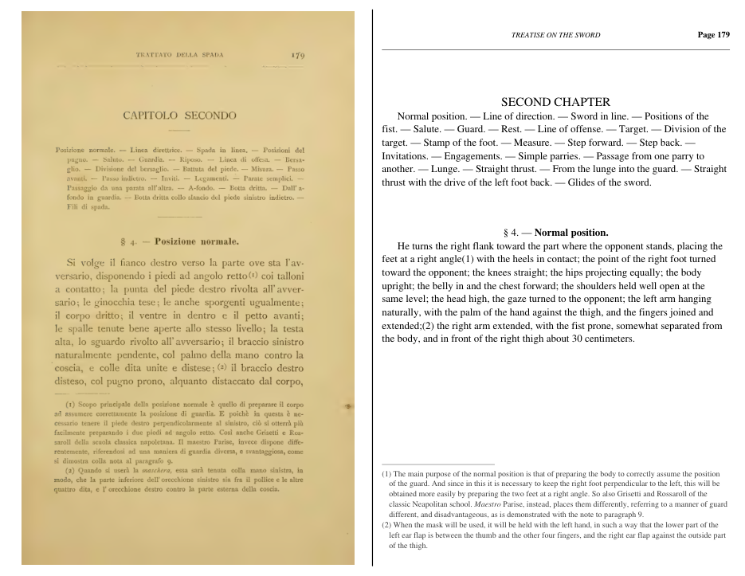
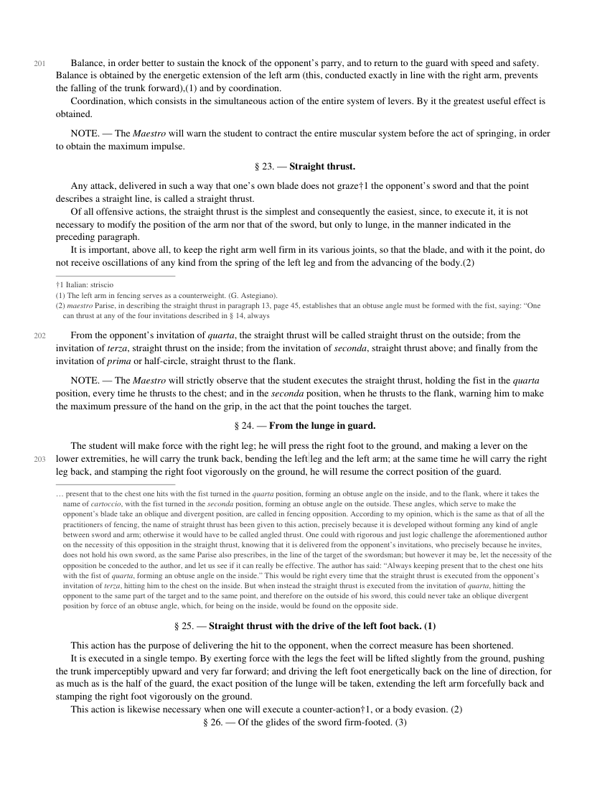
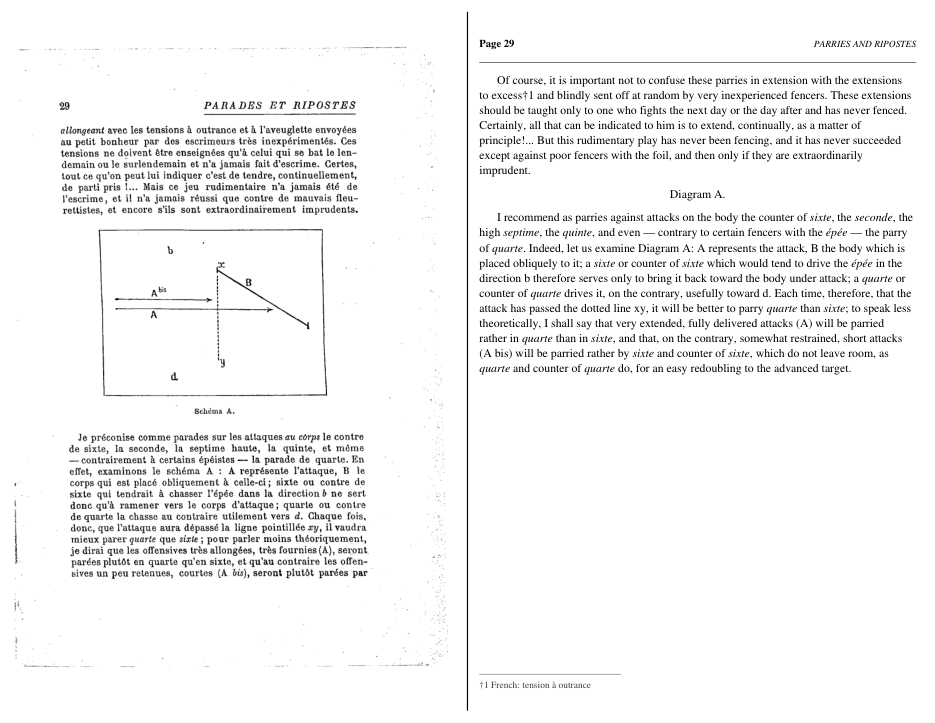
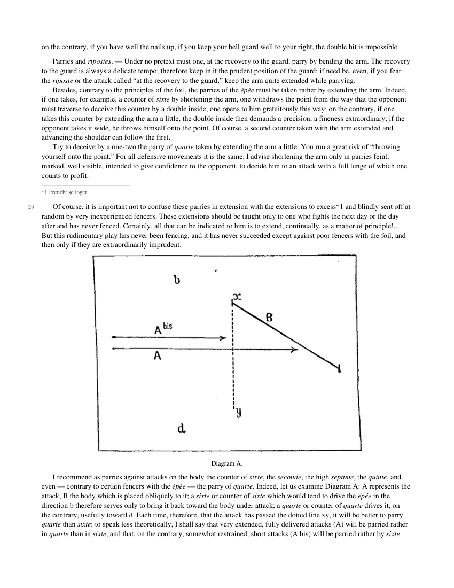
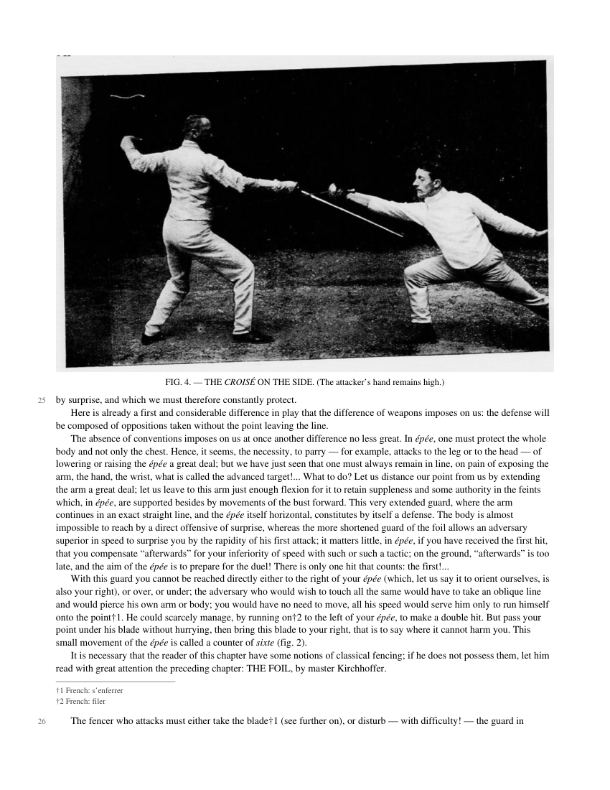

# Sample output

A few pages from two books the pipeline has translated, to show what it
produces. Each book gives two PDFs: a **Side by Side (Landscape)** copy
(scan on the left, translation on the right) and an **English Only
(Portrait)** reading copy. Every PDF opens with a cover page naming the
models and the pipeline revision behind it.

Page numbers below ("pdf N") are positions in the full PDF. The English
Only copy reads as continuous text: the book's own page numbers stand in
the left margin where each printed page begins, so a passage can be
found in the original.

## Masiello, *La scherma italiana di spada e di sciabola* (1887), Italian

**Cover page** (English Only, pdf 1): source, models, pipeline revision,
and the AI-translation notice.

**Chapter opening** (Side by Side, pdf 200): the chapter's summary of
contents, a section heading, and the author's footnotes at the foot of
the page.

**Lesson tables** (Side by Side, pdf 342): the book's two-column
lessons, the master's action beside the pupil's, drawn as ruled tables
as on the printed page.

**Reading copy** (English Only, pdf 83): printed pages 201–203, their
numbers in the margin. A sentence that runs over a printed page goes on
along the same line, a thin bar marking the page turn ("the left│leg").
Italian technical terms stay in italics (*quarta*, *seconda*, *terza*); a
† note gives the original word where the English is approximate
("graze†1" → Italian *striscio*); the author's own numbered notes follow
the paragraph that ends their page.

Excerpts: [English Only](masiello-1887_english-only_excerpt.pdf) (cover,
pdf 81–83, with two photographic plates) · [Side by Side](masiello-1887_side-by-side_excerpt.pdf)
(cover, pdf 200, 201, 342).

## Kirchhoffer, Joseph-Renaud, Lécuyer, *L'Escrime : fleuret, épée, sabre* (1911), French

**Diagram** (Side by Side, pdf 52): the scan keeps the diagram, so the
translation side carries only its caption; French terms (*sixte*,
*quarte*, *épée*) stay in italics, with a † note for "excess".

**The same diagram** (English Only, pdf 32): in the reading copy the
figure is placed with the text, beside printed page 29.

**Photograph and text** (English Only, pdf 30): a plate with its caption,
then printed pages 25 and 26 marked in the margin, with page 25's † notes
after its last paragraph.

Excerpts: [English Only](kirchhoffer-1911_english-only_excerpt.pdf)
(cover, pdf 30–32) · [Side by Side](kirchhoffer-1911_side-by-side_excerpt.pdf)
(cover, pdf 52–54).

## Sources and terms

- Masiello: scan from archive.org
  ([laschermaitalian00masi](https://archive.org/details/laschermaitalian00masi)).
- Kirchhoffer et al.: scan from Gallica, Bibliothèque nationale de
  France (source gallica.bnf.fr / BnF), free for non-commercial reuse.

Both original works are in the public domain. The translations are
machine output, shared under CC BY-NC-SA 4.0 (non-commercial, with
credit, same terms), as each cover page states. They are not a
replacement for a scholarly human translation.
